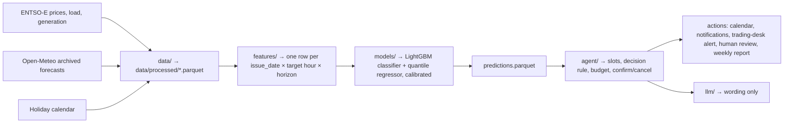

# GridSense: Zero-Cost Hours Agent

Smarthack XI 2026, PPC challenge "24h to Power PPC" ([brief](docs/Smarthack_XI_2026_Tema_PPC.pdf), in Romanian).
Full plan, rationale and timeline: [docs/project_plan.md](docs/project_plan.md).
Agent layer (alerts, dashboard, chatbot): [docs/agent_design.md](docs/agent_design.md).
ML plan (models, two-person split, working before data exists): [docs/ml_plan.md](docs/ml_plan.md).

GridSense forecasts which hours will have negative or near-zero electricity prices in Romania,
1–7 days ahead. It then plans "zero-cost hour" slots for PPC Energie customers, confirms or
cancels them after the day-ahead auction, sends targeted notifications, and hands uncertain
cases to a human. It automates PPC Energie's 2026 "Energie Electrică Activă Zero" pilot, in
which 83% of enrolled customers shifted consumption.

## How it works



| Step | What happens |
|---|---|
| Perceive | Download and validate market, weather and calendar data. |
| Estimate | Our model outputs `p_near_zero`, `p_cheap` and price P10/P50/P90 for each hour D+1…D+7. |
| Decide | Build 2–6 h slots between 09:00 and 18:00, score them by expected value, and apply thresholds, the monthly free-hours budget and confidence. Low-confidence or bad-data slots get `NEEDS_REVIEW`. |
| Act | Publish the calendar, notify customer segments, alert the trading desk, escalate to a human, write the weekly report. |

## Rules for anyone (or any coding agent) working in this repo

1. **No leakage.** Every feature is computed as of **10:00 Romanian time on the issue date**. Price lags are relative to the issue date (the latest known prices are for day D), never to the target date. Weather features are archived forecasts with the matching lead time, never observed weather.
2. **The test set (2026-03-01 → 2026-10-31) is evaluated once**, at the end. Tune everything on validation.
3. **Split dates, thresholds and paths come from [src/gridsense/config.py](src/gridsense/config.py).** Don't hard-code them.
4. **Teams talk through parquet files, not through each other's code.** Columns are defined in [src/gridsense/schemas.py](src/gridsense/schemas.py); read and write tables with `gridsense.io.read(name)` / `gridsense.io.write(df, name)`, which check them. If you change a column, update the schema and tell the team that consumes it.
5. **Timestamps are stored in UTC** (`ts_utc`) and converted to `Europe/Bucharest` only for calendar logic and display. Days have 23 or 25 hours at DST changes.
6. **Labels use the hourly mean** of the 15-minute prices (the day-ahead market moved to 15-minute periods in October 2025). `y_near_zero` (≤ 20 €/MWh) is the primary label and `y_cheap` (≤ 0 €/MWh) is secondary.
7. **The LLM never makes decisions.** It only writes text (notifications, reports), with a template fallback. All predictions come from our models and all decisions from the decision rule.
8. **Only public or synthetic data.** Anything synthetic is labelled as such here and in code. Never report a number obtained in fake mode.
9. **Commit small and often.** Commit history across the 24 hours is part of the score.
10. **Splits come only from `gridsense.splits.assign_split`.** Models implement `gridsense.models.base.Forecaster` so the evaluation harness can compare them all.

## Team and ownership

| Area | Owner | Code | Delivers |
|---|---|---|---|
| Data engineering | Data engineers | `src/gridsense/data/`, `src/gridsense/synthetic/customers.py` | `prices_hourly`, `grid_hourly`, `weather_fc`, `calendar` tables |
| ML-P: price forecasting | ML engineer | `models/price.py`, `features/`, `synthetic/market.py`, price baselines (seasonal naive, LEAR), conformal intervals | `training_table`, P10/P50/P90 model |
| ML-C: low-price classification | ML engineer | `models/classify.py`, classification baselines, calibration, `models/{evaluate,predict}.py`, SHAP | `p_near_zero` / `p_cheap` model, `predictions` table, evaluation reports |
| Agent | TBD | `src/gridsense/agent/`, `src/gridsense/llm/` | Alerts, plan, actions, decision trace |
| Demo | TBD | `app/` | Streamlit dashboard, slides |

Shared files (`config.py`, `schemas.py`, `io.py`, `splits.py`, `models/base.py`, `models/artifacts.py`, `models/train.py`): change them only after telling the people who depend on them.

### Working before the real data exists

Set `GRIDSENSE_DATA=fake` to read and write `data/fake/`, `models/fake/` and `reports/fake/` instead of the real folders (all gitignored). `make fake-data` writes synthetic market, weather and calendar tables that follow the schemas. `make fake-predictions` writes a realistic fake `predictions` table (test period, consistent probabilities and quantiles, a few `missing_weather` rows) so the agent and demo teams can build now. Switching to real data means running `make data`; no code changes.

## Repository layout

```
src/gridsense/
  config.py        paths (switched by GRIDSENSE_DATA), split dates, horizons, thresholds
  schemas.py       table column contract between teams
  io.py            read/write tables with column checks
  splits.py        train / val / test assignment
  data/            entsoe.py, weather.py, calendar.py, quality.py (input validation), build.py
  features/        build.py: training table, as-of-issue-time features
  models/          base.py (Forecaster interface), artifacts.py (save/load, experiment log),
                   price.py (P10/P50/P90), classify.py (p_near_zero, p_cheap), baselines.py,
                   train.py, calibrate.py, predict.py, metrics.py, evaluate.py, explain.py
  agent/           decision_rule.py, planner.py, actions.py, run.py
  llm/             wording.py
  synthetic/       market.py (fake market data), predictions.py (fake predictions),
                   customers.py (synthetic customer portfolio)
app/               Streamlit demo
tests/             pytest
data/              raw/, interim/, processed/, synthetic/, fake/ (selected processed tables are tracked)
models/            real/ and fake/ trained models (gitignored)
reports/           real/ results (committed) and fake/ (gitignored)
notebooks/         EDA and error analysis
docs/              hackathon brief, project plan, agent design, ML plan
```

## Modelling summary

- **Forecast setup:** issued daily at 10:00 for horizons D+1…D+7. D+1 is forecast before the day-ahead auction closes at 13:00.
- **Models:** LightGBM classifier (`y_near_zero`, `y_cheap`) with isotonic calibration on validation, plus LightGBM quantile regression (P10/P50/P90) with conformal adjustment. Horizon is a feature, so one model covers all horizons.
- **Baselines:** same hour last week, climatology (month × weekday × hour), solar-irradiance rule, and LEAR (Lasso autoregressive model per hour, the standard day-ahead benchmark).
- **Metrics (all by horizon):** PR-AUC, precision@k, Brier score, calibration curve, pinball loss, P10–P90 coverage, slot hit rate and cancellation rate.

## Setup

Requires [uv](https://docs.astral.sh/uv/) and Python 3.11. On macOS, LightGBM also needs `brew install libomp`.

```bash
uv sync
cp .env.example .env   # add your ENTSO-E API token
```

## Reproduce

```bash
make data       # build real day-ahead prices with ENTSOE_API_TOKEN
make features   # build the (issue_date, target_ts, horizon) training table
make train      # train both models on train, early-stop on val (TASK=price or TASK=classify for one)
make predict    # write the predictions table for the agent
make evaluate   # metrics vs baselines on validation
make evaluate FINAL=1   # test set, run once at the end
make agent      # run the agent loop and write actions to reports/
make app        # Streamlit demo (replay mode)
make test
make lint
```

Fake mode (no real data needed):

```bash
make fake-data
GRIDSENSE_DATA=fake make features train predict evaluate
```

## Data splits

| Split | Period | Use |
|---|---|---|
| Train | 2023-01-01 → 2025-02-28 | Model fitting |
| Validation | 2025-03-01 → 2025-09-30 | Tuning, calibration, decision thresholds |
| Test | 2026-03-01 → 2026-10-31 | Final evaluation, run once |

The final model is refit on all data up to 2026-02-28 before the test evaluation. Validation
covers spring and summer on purpose, because winter has almost no negative-price hours.

## Status

The [Romanian day-ahead price pipeline](docs/energy_market_data.md) writes native and hourly
Parquet files from ENTSO-E, with a pinned snapshot option that needs no token. See that guide
for date ranges, coverage checks and the weather join. Other real data stages are still stubs.

## Data sources

| Data | Source |
|---|---|
| Romanian day-ahead prices, load, generation | [ENTSO-E Transparency Platform](https://transparency.entsoe.eu) |
| Archived weather forecasts (by lead time) | [Open-Meteo](https://open-meteo.com) Previous Runs API |
| Romanian public holidays | [`holidays`](https://pypi.org/project/holidays/) Python package |
| Customer portfolio | **Synthetic**, calibrated to published PPC Energie pilot figures |

## Results

TBD
