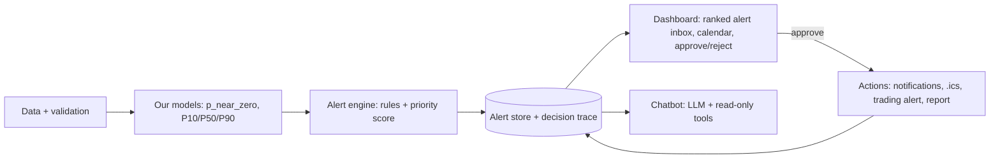

# Agent design: alerting dashboard + grounded chatbot

How the agent layer turns our model's forecasts into ranked alerts, actions and answers. It extends sections 7–9 of [project_plan.md](project_plan.md). The ML deliverable doesn't change: `predictions.parquet` (see `src/gridsense/schemas.py`) feeds the alert engine directly.

## Principles

1. **The model forecasts; the decision rule decides; the dashboard and chatbot only show and explain.** An LLM chatbot on its own earns no ML points and doesn't meet the brief.
2. **The pipeline runs on its own.** A daily run (or `--replay` over a test-period week) goes from input data to alerts and actions with no manual step in between. The dashboard reads what that run wrote; nobody has to trigger it.
3. **Every alert and action can be traced** to the prediction rows and model version that produced it.
4. **A human approves customer-facing actions** that aren't high-confidence. The agent says "I'm not sure" by raising a `needs_review` alert.

## Architecture

## Alert types

Each alert comes from the model's outputs or from the data checks.

| Type | Trigger | Audience | Approval |
|---|---|---|---|
| `zero_cost_opportunity` | Slot with P(near zero) ≥ τ and positive expected value | Customer team | Operator approves before customers are notified |
| `confirm_slot` / `cancel_slot` | D+1 auction result vs the planned slot | Customer team | Automatic for confirmations of high-confidence slots; cancellations notify the operator |
| `evening_scarcity` | Evening P50 or P90 above the scarcity threshold | Trading desk | Automatic (informational) |
| `needs_review` | Wide P10–P90 range, probability near τ on a high-value slot, or failed input checks | Operator | Operator decides |
| `data_quality` | Missing or stale feed, duplicate timestamps, values out of range | Data owner | Automatic (informational) |
| `model_drift` | Calibration or slot hit rate falling over recent weeks | ML owner | Automatic (informational) |

## Prioritization

Use a deterministic, explainable score, not the LLM:

$$\text{priority} = \text{expected value (€)} \times \text{confidence} \times \text{urgency}$$

- **Expected value:** from the decision rule in project_plan.md §7.2.
- **Confidence:** from the calibrated probability and the width of the P10–P90 range.
- **Urgency:** grows as the 12-hour customer notification deadline approaches.
- **Capacity limit:** the operator reviews at most `MAX_REVIEWS_PER_DAY` alerts a day; the rest are deferred or handled conservatively. The brief explicitly names limits like this.
- `data_quality` and `model_drift` alerts aren't ranked by value; they are always pinned to the top for their owner.

The weights and thresholds are tuned on validation and stored in `src/gridsense/config.py`.

## Alert record

Stored in the alert store (for example `reports/alerts.parquet` or SQLite) and appended to `reports/decisions.jsonl`. If a team adopts this, it should be added to `src/gridsense/schemas.py`.

| Field | Meaning |
|---|---|
| `alert_id` | Stable ID, cited by the chatbot and the dashboard |
| `created_at` | When the agent raised it (UTC) |
| `type` | One of the alert types above |
| `slot_start`, `slot_end` | Target window (UTC), if any |
| `audience` | customer_team, trading_desk, operator, data_owner, ml_owner |
| `priority`, `expected_value_eur`, `confidence`, `urgency_hours` | Inputs and result of the priority score |
| `status` | new, approved, rejected, auto_sent, expired, cancelled |
| `reason` | One-sentence explanation (template or LLM wording) |
| `prediction_ids`, `model_version` | Traceability back to the model output |
| `top_features` | Top SHAP contributions |
| `similar_days` | Nearest past days and their actual prices |
| `outcome` | Filled in later: actual cleared price and whether the alert was right |

## Actions

Each action writes a real artifact under `reports/<date>/`:

| Artifact | Contents |
|---|---|
| `calendar.ics` | Approved zero-cost slots; imports into any calendar app |
| `outbox/*.json` | Notifications per customer segment, ready to send by email or push |
| `trading_alert.json` | Expected shifted MWh and evening scarcity warnings |
| `review_queue.csv` | `needs_review` alerts with their reason |
| `weekly_report.md` | Energy shifted, value to PPC, cancellations, accuracy |
| `decisions.jsonl` | One line per decision: inputs, thresholds, budget state, label, approver |

## Dashboard (Streamlit, `app/`)

- **Alert inbox:** ranked by priority, filterable by type and audience, with Approve / Reject buttons. Approving triggers the matching action and updates the alert status.
- **Calendar:** the week ahead with slot labels (Confirmed / Likely / Possible / Needs review).
- **Slot detail:** probability, P10/P50/P90, SHAP explanation, similar past days, decision trace.
- **Model health:** recent calibration, slot hit rate, data-quality status.
- **Replay controls:** step through a test-period week day by day for the demo.
- **Chat panel:** the chatbot below.

## Chatbot

The LLM answers only by calling read-only tools, and every answer cites alert or decision IDs. "Answers based on previous findings" means querying the alert store and the decision trace; no document RAG is needed.

| Tool | Returns |
|---|---|
| `get_alerts(date, type)` | Alerts and their status |
| `get_forecast(date)` | Hourly `p_near_zero` and P10/P50/P90 |
| `explain_slot(alert_id)` | SHAP explanation, similar past days, decision trace |
| `get_history(start, end)` | Past alerts, actual outcomes, accuracy |
| `what_if_missing(feed)` | Reruns the pipeline without one input to show how the agent becomes more conservative |

Rules:
- The chatbot cannot approve, reject or change decisions. Those go through the dashboard buttons.
- If the LLM is unavailable, a handful of predefined questions (intent matching plus templates) keep the demo working.
- Keep it to these five tools. The ranked alert inbox is where most of the "agent" points come from.

## Demo flow

1. Replay starts on a spring 2026 test-period day; the inbox fills with ranked alerts.
2. The operator opens the top `zero_cost_opportunity`, sees why (SHAP + similar days) and approves it. The `.ics` file and the notifications appear.
3. The next day's auction arrives: one slot is confirmed automatically and one is cancelled, with the reason.
4. Remove the weather feed live: a `data_quality` alert is raised, and slots move to `needs_review`.
5. Ask the chatbot "Why was Saturday cancelled?" It answers by citing the alert and decision IDs.
6. Show the weekly report.

## Ownership

| Piece | Code | Owner |
|---|---|---|
| Alert engine, priority score, actions, alert store | `src/gridsense/agent/` | Agent owner |
| Chatbot tools and LLM wording | `src/gridsense/llm/` | Agent owner |
| Dashboard | `app/` | Demo owner |
| `predictions.parquet`, SHAP, similar days, drift metrics | `src/gridsense/models/` | ML engineers |
| Input checks feeding `data_quality` alerts | `src/gridsense/data/quality.py` | Data engineers |
