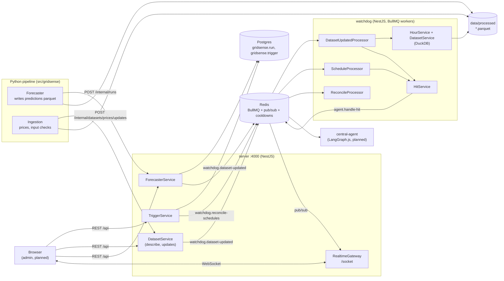

# GridSense — how it works

_Written 2026-11-07 against the TypeScript code as built. The product and the ML side are in [docs/project_plan.md](../../docs/project_plan.md) and [docs/agent_design.md](../../docs/agent_design.md); these pages explain the running system, flow by flow._

The Python pipeline forecasts; the **Watchdog** checks the admin's **triggers** against what it forecast (and against the prices, once the auction clears); every trigger that holds becomes a **hit**, handed to the **agent**, which decides and acts — pausing for an admin when it isn't sure.

| Page | What it covers |
|---|---|
| [reporting-a-run.md](reporting-a-run.md) | Python's `POST /internal/runs` → the run saved → the predictions update queued → live on `forecaster:runs` |
| [checking-an-update.md](checking-an-update.md) | A dataset's file changed → each trigger reads its rows past its watermark → the hours they're about → evaluated, watermark moved. Also: replaying the dummy week |
| [raising-a-hit.md](raising-a-hit.md) | A trigger held → cooldown → the agent's job, its thread id → `watchdog:hit:raised` |
| [scheduled-triggers.md](scheduled-triggers.md) | Triggers on the clock: reconciling BullMQ job schedulers, a schedule firing |
| [editing-triggers.md](editing-triggers.md) | The admin's editor: describing a dataset's columns, create / update / delete, what the Watchdog does after |
| [handling-a-hit.md](handling-a-hit.md) | **Planned, not built**: the central agent's graph, review, resume |
| [realtime.md](realtime.md) | Every channel, who publishes on it, and the `/socket` gateway |

## The pieces



Three ways things talk, each for one job:

| How | Used for | Why this one |
|---|---|---|
| **HTTP** — `/api` (browser), `/internal` (Python, Watchdog) | Reads and writes that need an answer now: save a run, list triggers, get the run before this one | Synchronous, validated with zod on both ends (`*.API`) |
| **BullMQ queues** on Redis | Handing work to another process: "check these hours", "handle this hit" | Durable: a job waits while its worker is down; deterministic job ids drop duplicates |
| **Redis pub/sub** → `/socket` | Telling browsers what just happened | Live and lossy: nobody listening, nothing kept |

The server owns Postgres. The Watchdog never touches it — it reads runs and triggers over `/internal`, and parquet files from disk with DuckDB.

## Queues

| Queue | Job | Produced by | Consumed by | Job id |
|---|---|---|---|---|
| `watchdog.dataset-updated` | `Dataset.Update` `{ dataset }` | `ForecasterService.reportRun`, `DatasetService.reportUpdate` | `DatasetUpdatedProcessor` (concurrency 1) | — (a repeated update finds no new rows) |
| `watchdog.schedule` | `{ triggerId }` | BullMQ job schedulers, one per scheduled trigger | `ScheduleProcessor` (concurrency 1) | BullMQ's, per firing |
| `watchdog.reconcile-schedules` | `{}` | `TriggerService` on every write; the Watchdog on boot | `ReconcileProcessor` (concurrency 1) | — |
| `agent.handle-hit` | `Trigger.Hit` | `HitService.raise` | central-agent (planned) | the hit's thread id |
| `agent.resume` | `{ threadId, decision, note }` | the review endpoint (planned) | central-agent (planned) | — |

The queues are declared once in `shared/domain` (`Watchdog.Queue`, `Agent.Queue`) with `Foundations.Queue.define`: producer and consumer share the name and the zod schema, and know nothing else of each other.

## Running it

```sh
npm run infra        # postgres:16 + redis:7 (docker compose)
npm run dev          # server :4000 + watchdog, nodemon
```

`.env` (from `.env.example`): `DATABASE_URL`, `REDIS_URL`, `GRIDSENSE_SERVER_URL` (the Watchdog's way to the server), `DATASET_DIR` (relative to the repository root; `data/replay` for the dummy week: `uv run python -m gridsense.replay --from 2026-05-13 --to 2026-05-15 --create-triggers`).
