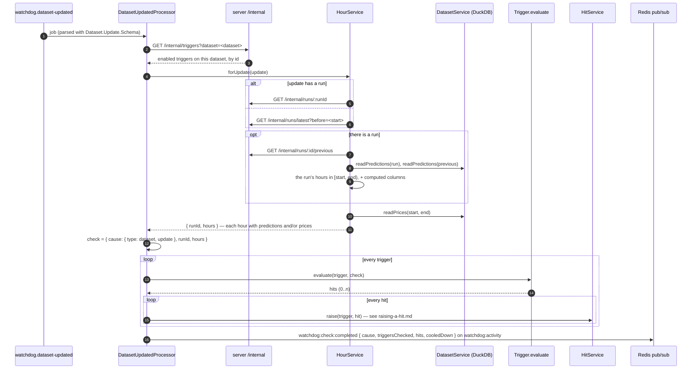

# Checking a dataset update

A job on `watchdog.dataset-updated`: a `Dataset.Update`, saying **which dataset** changed and **which hours**.

```jsonc
{ "dataset": "predictions", "start": "2026-05-13T21:00:00Z", "end": "2026-05-20T21:00:00Z", "runId": "0196…a" }   // a run's forecast
{ "dataset": "prices",      "start": "2026-05-15T21:00:00Z", "end": "2026-05-16T21:00:00Z", "runId": null }      // the auction cleared Saturday 16
```

`Dataset.Update` (`shared/domain/Dataset/Update.ts`): `dataset`, `[start, end)`, and `runId` — the run that wrote predictions, `null` otherwise. Its key, `Dataset.Update.getKey`, is the job id: `predictions_<runId>` or `prices_<window key>`, so the same update reported twice is checked once.

| Who reports it | When | How |
|---|---|---|
| `ForecasterService.reportRun` | Python reported a run ([reporting-a-run.md](reporting-a-run.md)) | `{ dataset: "predictions", start, end, runId }` from the report |
| `DatasetService.reportUpdate` | Python ingested the auction's prices for a day | `POST /internal/datasets/prices/updates { start, end }` — `Dataset.API.Internal.ReportUpdate`, local midnight to local midnight |

A trigger says which dataset it watches: `on: { type: "dataset", dataset: "prices" }`. The Watchdog doesn't know *why* the hours changed — a new run, an auction — only what changed.

## The flow

`DatasetUpdatedProcessor` (`packages/watchdog/src/processors/dataset-updated.processor.ts`), concurrency 1: updates are checked one at a time, in order — the prices check must see the run reported before it.



## The hours

One rule, whatever the dataset: **the hours in `[start, end)`, each with every dataset's values that exist for it.**

- **Prices**: the cleared prices of those hours, where they exist.
- **Predictions**: the forecast of the update's run if it has one; otherwise the **latest run issued before `start`** — what we knew when the hours began. `runId` in the check is that run, or `null` if there was none (then the hours have only prices).

So a `predictions` update checks the run's 168 hours, with prices only for hours already delivered (mostly none). A `prices` update for an auction day checks that day's 23–25 hours, with their prices and the forecast the day had. A trigger that joins both (T3 "forecast miss": `predictions.p_near_zero ≥ 0.7` and `prices.price_mean > 20`) belongs on `prices`.

A `Trigger.Check` (`shared/domain/Trigger/Check.ts`):

```ts
interface Check {
    cause: Check.Cause            // { type: "dataset", update } | { type: "schedule", firedAt }
    runId: Run.Id | null
    hours: Check.Hour[]           // sorted by time
}

// One delivery hour, with every dataset's values that exist for it.
type Hour = {
    at:     Date
    values: Partial<Record<Dataset.Name, Record<string, number | string>>>
}
```

```jsonc
// an hour of the predictions update for run B, Saturday 16 May 12:00 local
{
  "at": "2026-05-16T09:00:00Z",
  "values": {
    "predictions": {
      "p_near_zero": 0.86, "p_cheap": 0.91, "price_p10": -38, "price_p50": 2, "price_p90": 24,
      "horizon_days": 3, "data_quality": "ok",
      "local_hour": 12, "weekday": 5, "interval_width": 62, "p_near_zero_change": 0.04   // computed
    }
    // no "prices": this hour hasn't cleared yet
  }
}
```

- **Every column of the file comes along** (`select *`, loose row schemas): a column Python adds reaches the triggers with no change here.
- **Computed columns** are added next to the file's: `Dataset.Predictions.compute(row, previous)` → `local_hour`, `weekday`, `interval_width`, `p_near_zero_change`; `Dataset.PricesHourly.compute(row)` → `local_hour`, `weekday`. `p_near_zero_change` needs the same hour in the run before; on an hour's first forecast it's absent.
- **Bad input data** is a column, not an event: `data_quality` (`ok` · `degraded` · `failed`) on every prediction. T4 "degraded data" is a trigger on `predictions` with `data_quality in [degraded, failed]`.

## Evaluating

`Trigger.evaluate(trigger, check)` (`shared/domain/Trigger/evaluate.ts`) — pure, tested in `Trigger/tests`:

1. A trigger on a schedule holds once: one hit, no window, no evidence ([scheduled-triggers.md](scheduled-triggers.md)).
2. Otherwise each hour is matched against the conditions (`match: all | any`). A condition reads `hour.values[dataset][column]`; **a missing value, or one of the wrong type, doesn't hold** — there's no column validation on save, so this is where a typo or a dropped column ends up.
3. No matching hour → no hits.
4. The matching hours are split by `grouping`:
   - `hour` — one hit per hour;
   - `window { minHours, maxHours }` — consecutive hours within a local day, cut at `maxHours`, pieces under `minHours` dropped (`Time.Window.group`);
   - `run` — one hit for all of them, no window.
5. Each hit carries `evidence`: for each column the conditions read, `<dataset>.<column>.min / .mean / .max`, or `<dataset>.<column>=<value>` counts for text.

```jsonc
// T1 "Zero-cost window" on run A's update
{
  "triggerId": "0196…",
  "cause": { "type": "dataset", "update": { "dataset": "predictions", "start": "…", "end": "…", "runId": "0196…a" } },
  "runId": "0196…a",
  "window": { "key": "20260516T0800Z-20260516T1300Z", "start": "2026-05-16T08:00:00Z", "end": "2026-05-16T13:00:00Z", "hours": 5 },
  "matchedHours": 5,
  "evidence": { "predictions.p_near_zero.min": 0.81, "predictions.p_near_zero.mean": 0.86, "predictions.p_near_zero.max": 0.9,
                "predictions.local_hour.min": 11, "predictions.local_hour.mean": 13, "predictions.local_hour.max": 15,
                "predictions.data_quality=ok": 5 }
}
```

## When it fails

A thrown error fails the job (BullMQ keeps the last 1000 failed). A server that's down, a missing file, a row that doesn't parse — the whole check fails. Hits raised before the failure stay raised; their thread ids make a retry harmless.
