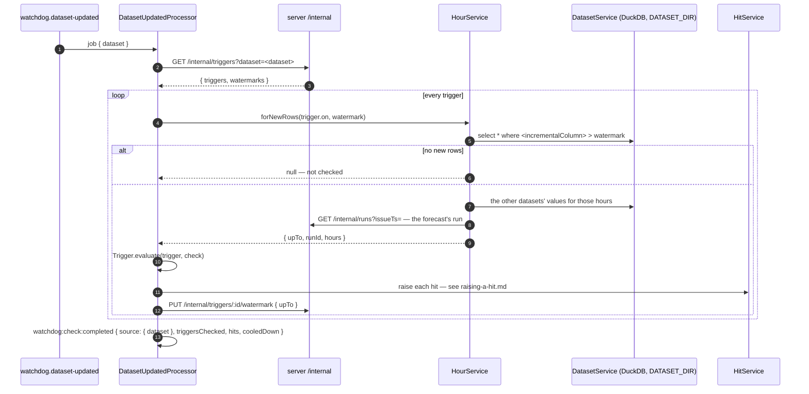

# Checking a dataset update

A job on `watchdog.dataset-updated`: a `Dataset.Update`, saying only **which dataset's file changed**.

```jsonc
{ "dataset": "predictions" }   // a run appended its rows — queued by ForecasterService.reportRun
{ "dataset": "prices" }        // a day's cleared prices were appended — POST /internal/datasets/prices/updates
```

The update doesn't say which rows are new: **each trigger finds its own**, past its **watermark** on its **incremental column** — a timestamp column that only grows as rows are appended.

```jsonc
"on": { "type": "dataset", "dataset": "predictions", "incrementalColumn": "issue_ts" }   // a run's rows
"on": { "type": "dataset", "dataset": "prices",      "incrementalColumn": "ts_utc" }     // a cleared day's hours
```

| Who reports it | When | How |
|---|---|---|
| `ForecasterService.reportRun` | Python reported a run ([reporting-a-run.md](reporting-a-run.md)) | queues `{ dataset: "predictions" }` |
| `DatasetService.reportUpdate` | Python appended a day's cleared prices | `POST /internal/datasets/prices/updates` (no body) — `Dataset.API.Internal.ReportUpdate` |

From Python: `gridsense.report_dataset_updated` (`report_run`, `report_dataset_updated`).

## Watermarks

`gridsense.trigger.watermark` — the largest value of the trigger's incremental column the Watchdog has read. It isn't part of `Trigger.Schema`: the admin never sees or sends it.

| When | Watermark |
|---|---|
| A trigger on a dataset is created | the column's current max in the file (`DatasetService.getLatest`): it reads only rows appended after it was saved. Null if there's no file yet (then it reads everything once). 400 if the column isn't in the file or isn't a timestamp |
| It's updated onto another dataset or column | reset the same way; otherwise kept |
| The Watchdog checks it | moved to the max of the new rows it read (`PUT /internal/triggers/:id/watermark`), after its hits are raised |

A repeated or lost update costs nothing: the next one finds exactly the rows past the watermark. A crash between raising hits and moving the watermark re-reads the same rows; the hits' thread ids are the same, so the agent handles them once.

## The flow

`DatasetUpdatedProcessor` (`packages/watchdog/src/processors/dataset-updated.processor.ts`), concurrency 1 — updates in order, so the prices check sees the run reported before it.



A trigger whose incremental column has gone from the file is logged and skipped; the others are still checked.

## The hours

`HourService.forNewRows` turns the new rows into the hours they're about, each with every dataset's values that exist for it:

- **predictions**: each hour's latest forecast among the new rows (one run, usually), with the cleared prices of hours already delivered (mostly none).
- **prices**: the cleared hours, with the forecast **each day had** — the latest run issued before the day's local midnight (`DatasetService.getLatestIssueTs`). That's how T3 "forecast miss" (`predictions.p_near_zero ≥ 0.7` and `prices.price_mean > 20`) compares what we said with what cleared.

`runId` in the check is the run of that forecast (`Forecaster.API.Internal.findRun` by `issueTs`), or null if it was never reported.

Both files are read from `DATASET_DIR`: every run appends to the same `predictions.parquet`, one `issue_ts` per run. `Run.predictionsPath` is kept for the record only.

A `Trigger.Check` (`shared/domain/Trigger/Check.ts`):

```ts
interface Check {
    cause: Check.Cause    // { type: "dataset", dataset, incrementalColumn, after, upTo } | { type: "schedule", firedAt }
    runId: Run.Id | null
    hours: Check.Hour[]   // sorted by time
}

// One delivery hour, with every dataset's values that exist for it.
type Hour = {
    at:     Date
    values: Partial<Record<Dataset.Name, Record<string, number | string>>>
}
```

```jsonc
// an hour of run B's new rows, Saturday 16 May 12:00 local
{
  "at": "2026-05-16T09:00:00Z",
  "values": {
    "predictions": {
      "p_near_zero": 0.86, "p_cheap": 0.91, "price_p10": -38, "price_p50": 2, "price_p90": 24,
      "horizon_days": 2, "data_quality": "ok",
      "local_hour": 12, "weekday": 5, "interval_width": 62, "p_near_zero_change": 0.04   // computed
    }
    // no "prices": this hour hasn't cleared yet
  }
}
```

- **Every column of the file comes along** (`select *`, loose row schemas): a column Python adds reaches the triggers with no change here.
- **Computed columns** are added next to the file's: `Dataset.Predictions.compute(row, previous)` → `local_hour`, `weekday`, `interval_width`, `p_near_zero_change` (against the same hour in the run issued before, from the same file); `Dataset.PricesHourly.compute(row)` → `local_hour`, `weekday`.
- **Bad input data** is a column, not an event: `data_quality` (`ok` · `degraded` · `failed`). T4 "degraded data" is a trigger on `predictions` with `data_quality in [degraded, failed]`.

## Evaluating

`Trigger.evaluate(trigger, check)` (`shared/domain/Trigger/evaluate.ts`) — pure, tested in `Trigger/tests`:

1. A trigger on a schedule holds once: one hit, no window, no evidence ([scheduled-triggers.md](scheduled-triggers.md)).
2. Otherwise each hour is matched against the conditions (`match: all | any`). A condition reads `hour.values[dataset][column]`; **a missing value, or one of the wrong type, doesn't hold** — conditions' columns aren't validated on save.
3. No matching hour → no hits.
4. The matching hours are split by `grouping`: `hour` — one hit per hour; `window { minHours, maxHours }` — consecutive hours within a local day, cut at `maxHours`, pieces under `minHours` dropped; `run` — one hit for all of them, no window.
5. Each hit carries `evidence`: for each column the conditions read, `<dataset>.<column>.min / .mean / .max`, or `<dataset>.<column>=<value>` counts for text.

```jsonc
// T3 "Forecast miss" on Saturday's prices, one of five hours (from the replay)
{
  "triggerId": "0196…",
  "cause": { "type": "dataset", "dataset": "prices", "incrementalColumn": "ts_utc", "after": "2026-05-15T20:00:00Z", "upTo": "2026-05-16T20:00:00Z" },
  "runId": "0196…c",
  "window": { "key": "20260516T0700Z-20260516T0800Z", "start": "2026-05-16T07:00:00Z", "end": "2026-05-16T08:00:00Z", "hours": 1 },
  "matchedHours": 1,
  "evidence": { "predictions.p_near_zero.min": 0.7594, "predictions.p_near_zero.mean": 0.7594, "predictions.p_near_zero.max": 0.7594,
                "prices.price_mean.min": 77.64, "prices.price_mean.mean": 77.64, "prices.price_mean.max": 77.64 }
}
```

## Replaying the dummy week

`uv run python -m gridsense.replay --from 2026-05-13 --to 2026-05-15 --create-triggers` (with `DATASET_DIR=data/replay`) starts the files at what was known on the 13th, saves T1–T5, then appends each day's run (10:00) and the next day's prices (14:00) and reports them. On 15 May's auction, T3 raises five hits for Saturday 16, 10:00–15:00 local — the forecast the agent announced and must cancel.
