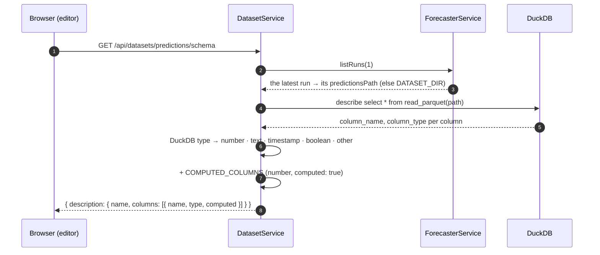
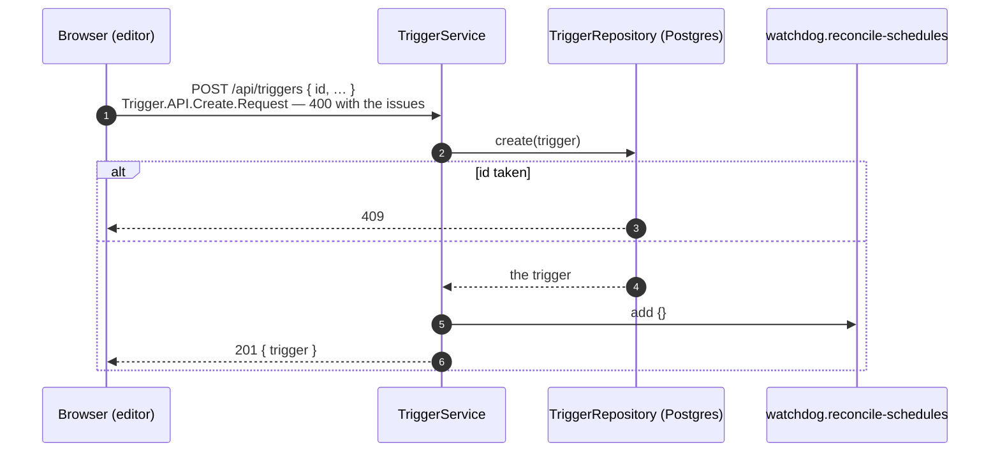

# Editing triggers

The admin's trigger editor (frontend, planned) → `/api/triggers` and `/api/datasets/:name/schema`.

A trigger, as saved (`Trigger.Schema`, `shared/domain/Trigger/Schema.ts`):

```jsonc
{
  "id":              "0196…",                 // made by the client (Trigger.createId, UUIDv7)
  "name":            "Forecast miss",
  "description":     "Hours we called near zero that cleared above 20 €/MWh.",
  "enabled":         true,
  "on":              { "type": "dataset", "dataset": "prices" },            // or { type: "schedule", cron }
  "match":           "all",                                                  // or "any"
  "conditions": [
    { "dataset": "predictions", "column": "p_near_zero", "operator": ">=", "value": 0.7 },
    { "dataset": "prices",      "column": "price_mean",  "operator": ">",  "value": 20 }
  ],
  "grouping":        { "type": "hour" },       // or { type: "window", minHours, maxHours } · { type: "run" }
  "cooldownMinutes": 0
}
```

`Trigger.Schema` checks the shape and what doesn't depend on any file: no conditions on a trigger on the clock (it has no hours), `minHours ≤ maxHours`, a value that fits its operator (`between` takes `[low, high]`, `in` a list). It does **not** check that a column exists, or its type: the files belong to Python and change under us. The editor asks instead.

## 1. Describing a dataset

`GET /api/datasets/:name/schema` — `Dataset.API.describe(api, name)`, for the column picker.



```jsonc
{ "description": { "name": "predictions", "columns": [
  { "name": "issue_ts",           "type": "timestamp", "computed": false },
  { "name": "p_near_zero",        "type": "number",    "computed": false },
  { "name": "data_quality",       "type": "text",      "computed": false },
  { "name": "local_hour",         "type": "number",    "computed": true  },
  { "name": "p_near_zero_change", "type": "number",    "computed": true  }
] } }
```

The editor offers number operators (`>=`, `<=`, `>`, `<`, `between`) on `number` columns and `==`, `!=`, `in` on `text`. Predictions are described from the **latest run's** file — the one the next check will look like; prices from `DATASET_DIR`.

## 2. Saving

Create and update are two endpoints. The id is the client's, so a retried create can't make two triggers.

| Request | Does | Errors |
|---|---|---|
| `POST /api/triggers` — body `Trigger` | `insert … on conflict (id) do nothing` | 400 schema · **409** the id exists |
| `PUT /api/triggers/:id` — body `Trigger` | updates every field, `updated_at = now()` | 400 schema · **400** body id ≠ path id · 404 |
| `DELETE /api/triggers/:id` | deletes, returns what it was | 404 |
| `GET /api/triggers`, `GET /api/triggers/:id` | by id | 404 |



Writes go through `TriggerService` so every one queues a reconcile; reads go to the repository directly.

## What the Watchdog does after

Nothing has to be pushed to it for **dataset** triggers: it lists the enabled triggers on a dataset each time it updates (`GET /internal/triggers?dataset=`), so a saved trigger counts from the next update on. **Scheduled** triggers need their BullMQ scheduler created, changed or removed — that's the reconcile job ([scheduled-triggers.md](scheduled-triggers.md)).

Disabling (`enabled: false`) leaves the trigger saved; the queries filter on `enabled`, and the reconcile removes its scheduler.

## Storage

`gridsense.trigger`: `on` → `checked_on` (jsonb), `match` → `match_mode`, `conditions` (jsonb), `grouping` → `hit_grouping` (jsonb), `cooldown_minutes`. The jsonb columns hold the zod-validated shapes as they are and are parsed again on the way out (`TriggerDB.toDomain`). An index on `checked_on ->> 'dataset'` where enabled serves the Watchdog's lookup.
