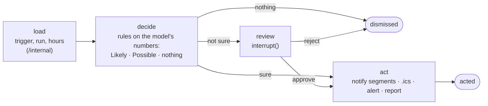
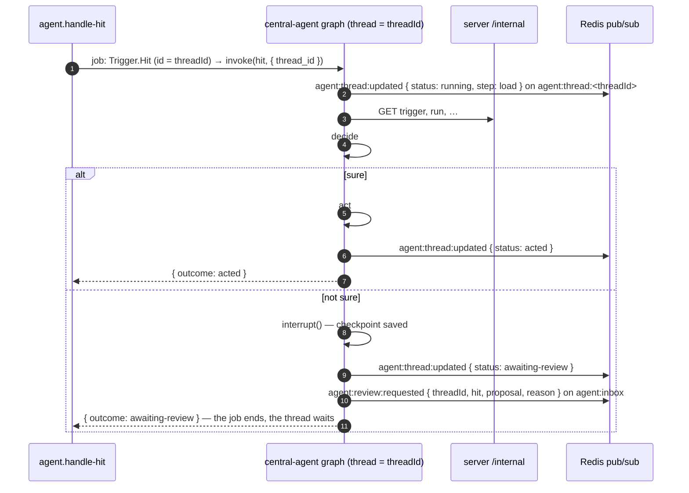
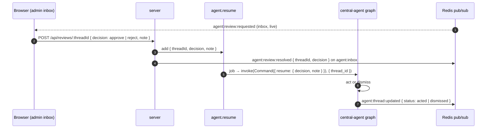

# Handling a hit

_**Planned, not built.** The contracts exist in `shared/domain/Agent` (queues and events); the `central-agent` package doesn't yet. This page is the design the code will follow._

A job on `agent.handle-hit` — a `Trigger.Hit`, its job id the hit's thread id ([raising-a-hit.md](raising-a-hit.md)). The agent decides what the hit means and acts; when it isn't sure, it pauses and asks an admin.

## The graph

One LangGraph.js graph, one **thread per hit**: `thread_id = threadId`, checkpointed in Postgres, so a paused thread survives a restart.

The decision is **deterministic, in code**, on the model's outputs in the hit's evidence (`p_near_zero`, `interval_width`, `data_quality`, …). The LLM only writes the text — the notification, the reason, the report — from those numbers, with a template fallback when it's unavailable.

## Handling

The job doesn't wait for the admin: it ends at the pause. The thread lives in the checkpoint until a decision comes.

## Review and resume

## Outcomes

`Agent.Queue.Outcome`: `acted` (carried out its actions) · `awaiting-review` (paused) · `dismissed` (nothing to do, or rejected). `Agent.Event.Thread.Status` adds `running` and `failed` for the live view.

## To decide

- Where actions and the decision trace are stored (a `gridsense.thread` table, or only LangGraph's checkpoints).
- The review endpoint's home: a `Review` service on the server, or the agent's own HTTP.
- Superseding: a later hit on the same window (T2 "forecast dropped", T3 "forecast miss") should find the earlier thread's announcement and correct it — by window key.
