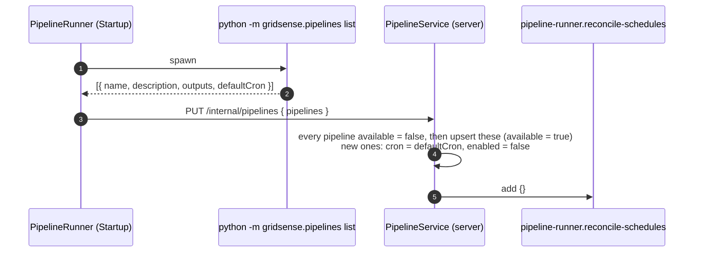
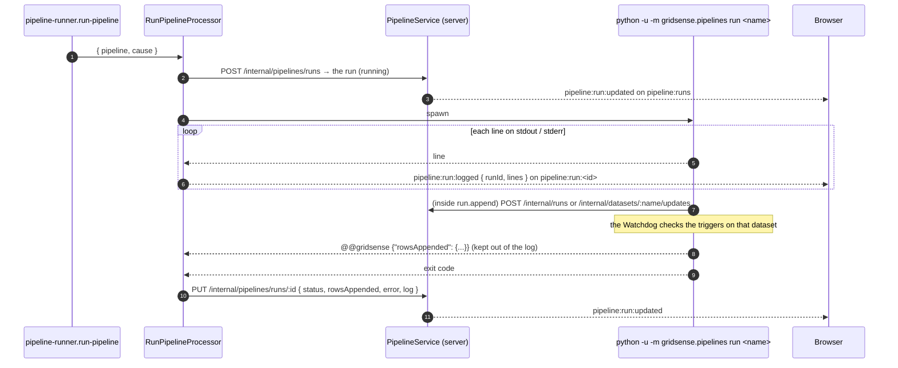

# Pipelines

_The Python that keeps the datasets up to date, run by the **PipelineRunner** (`packages/pipeline-runner`) on schedules set in the UI (Pipelines page)._

A pipeline is defined in Python and only there. When it runs is set in the UI and saved on the server. The PipelineRunner sits between the two: it reads the definitions from Python, keeps one BullMQ job scheduler per schedule that is switched on, and runs each pipeline as a subprocess.

```python
# src/gridsense/pipelines/demo.py
@pipeline("prices", "Appends the next day's cleared prices.", outputs=["prices"], default_cron="15 14 * * *")
def prices(run: Run) -> None:
    rows = ...                                   # what is new
    run.append("prices", rows, key=["ts_utc"])  # written whole, reported, counted
```

| | Where |
|---|---|
| Definitions (name, description, outputs, default cron) | Python: `@pipeline` in `src/gridsense/pipelines/` |
| Schedule (cron, Romanian time; on/off) | Postgres `gridsense.pipeline`, set from the UI |
| Runs (status, rows appended, error, whole log) | Postgres `gridsense.pipeline_run` |
| The data | the parquet files in `DATASET_DIR`, as before |

## 1. Boot: the definitions



A pipeline that is new in Python shows up switched off: nothing runs until someone turns it on. A pipeline that disappeared from Python stays in the table with `available: false`, and its history is kept. If Python can't be read (for example, a syntax error), the runner logs the error and reconciles anyway, so the schedules saved before keep running.

## 2. Schedules: the reconcile

`PUT /api/pipelines/:name/schedule { cron, enabled }` saves the schedule and queues a reconcile. Then `ReconcileProcessor` runs:

1. `GET /internal/pipelines/scheduled` returns the schedules that are available and enabled.
2. It calls `upsertJobScheduler(<pipeline name>, { pattern: cron, tz: Europe/Bucharest }, { pipeline, cause: 'schedule' })` for each of them.
3. It removes every scheduler whose pipeline isn't in that list.

The scheduler's id is the pipeline's name, so there is never more than one scheduler per pipeline.

## 3. A run

`Run now` (`POST /api/pipelines/:name/runs`, 202) and a scheduler firing both queue the same job on `pipeline-runner.run-pipeline`: `{ pipeline, cause }`.



- **One run at a time** (`concurrency: 1`), because pipelines append to the same files.
- **`run.append(dataset, rows, key=[...])`** writes only the rows whose key isn't in the file yet, so a pipeline run twice appends nothing the second time. It writes to a `.partial` file and renames it into place, so the Watchdog never reads a half-written file. It then reports the update (`predictions` as a run with its `model_version`; anything else as a dataset update), and finally prints the marker the runner counts.
- **Failure:** the pipeline raises, Python prints the traceback and exits 1, and the run is saved as `failed` with `Exited with 1`. If the process couldn't start at all, the run is also `failed`, with the spawn error as its error.
- **The log:** lines stream live while the run is going; the whole log is saved once the run ends. A browser that opens a run halfway sees the lines from then on, and the whole log once the run finishes.

## Configuration (.env)

| Variable | Default | |
|---|---|---|
| `PIPELINE_RUNNER_PORT` | 4200 | `/health` |
| `PIPELINE_PYTHON` | `uv run python` | how the runner starts the repository's Python; it runs from the repository root |
| `DATASET_DIR` | `data/processed` | where pipelines write, the same folder the server and the Watchdog read |

## The demo pipelines

`prices` (14:15) and `forecast` (10:00) in `demo.py` are stand-ins until the real ingestion and model run exist. Each run appends the next day of the synthetic dummy after what the file already has. Once the dummy runs out, they repeat the last day, shifted one day later. **Everything they write is fake.** Switch them off once the real pipelines are in place.

To add a real pipeline: write a module in `src/gridsense/pipelines/`, import it in `__main__.py`, and restart the PipelineRunner. The pipeline appears in the UI switched off.
