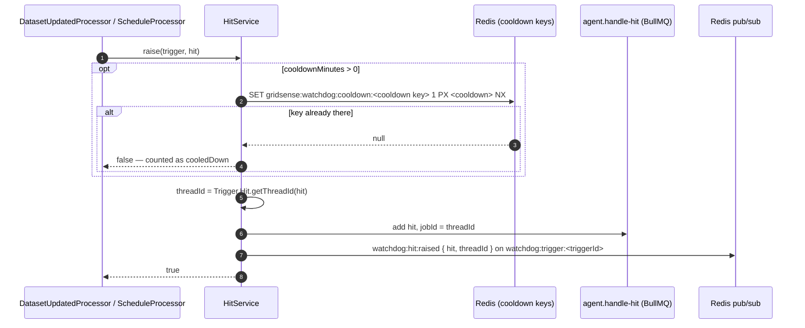

# Raising a hit

`HitService.raise(trigger, hit)` (`packages/watchdog/src/services/hit.service.ts`) — called for every hit `Trigger.evaluate` returns, by [the update check](checking-an-update.md) and [a schedule firing](scheduled-triggers.md). Returns `false` when the hit was held back by its cooldown.

## The flow

## Two keys

Both from `Trigger.Hit` (`shared/domain/Trigger/Hit.ts`). They answer different questions.

| Key | Shape | Question | Example |
|---|---|---|---|
| **Cooldown key** `getCooldownKey` | `<triggerId>_<window key \| run>` | "Did this trigger already tell the agent about these hours lately?" | `0196…_20260516T0800Z-20260516T1300Z` |
| **Thread id** `getThreadId` | `<cooldown key>_<occasion>` | "Is this the same hit, reported twice?" | `0196…_20260516T0800Z-20260516T1300Z_run-0196…a` |

The **occasion** is what the hit came from: the update's key (`predictions_<runId>`, `prices_<window key>`) or `schedule-<firedAt ms>`.

- **Cooldown** works across runs. Run A and run B both find Saturday 11–15 cheap; with a 24 h cooldown, only run A's hit reaches the agent. A window that shifts (11–15 → 12–15) is a new key, so it does get through. `cooldownMinutes: 0` means every hit goes through (T3 "forecast miss" wants one per hour, every time).
- **Thread id** works within one occasion. It's the BullMQ job id — a job with an id BullMQ still holds (the last 1000 completed or failed) is ignored — and the agent's LangGraph thread. A retried update raises the same thread ids, so the agent handles each hit once.

The cooldown is claimed **before** queueing, with `NX`: two hits racing for the same key, one wins. If queueing then fails, the window stays cooled down without a hit — acceptable for a hackathon, worth a note.

## What gets created

| Where | What |
|---|---|
| Redis `gridsense:watchdog:cooldown:<cooldown key>` | `1`, expiring after `cooldownMinutes` |
| `agent.handle-hit` | one job: the `Trigger.Hit`, id = thread id |
| `watchdog:trigger:<triggerId>` | `watchdog:hit:raised { hit, threadId }` — the trigger's page shows its hits live |

The agent's side: [handling-a-hit.md](handling-a-hit.md).
