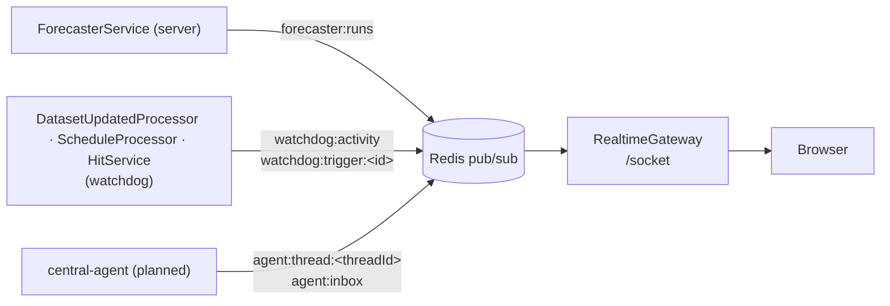
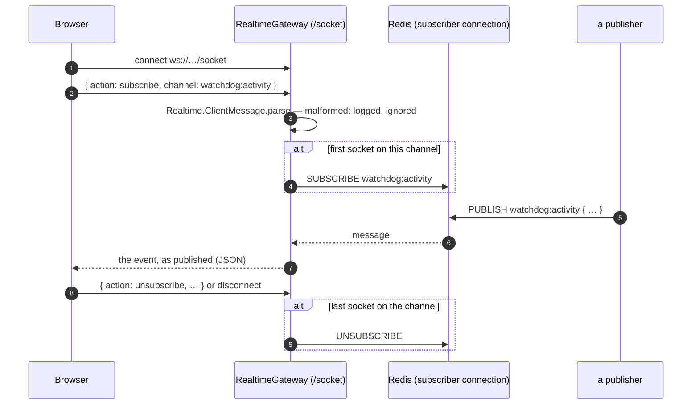

# Realtime

_Ported from Quarry's Realtime, without authorization: any browser may subscribe to any channel._

Services publish events over Redis pub/sub (`RealtimeService.emitEvent`, `shared/server/realtime.ts`); the server's `RealtimeGateway` relays them to browsers over one WebSocket at `/socket`. Live and lossy: an event nobody is subscribed to is gone. Anything a page needs on load comes from REST; the socket only tells it what changed after.



## Channels and events

Each domain declares its own (`<Domain>/Event.ts`): a branded channel type, its channels, a discriminated union on `type` (`"domain:entity:verb"`), and `create = Realtime.Event.defineFactory(Schema)`.

| Channel | Event | Published by | Who listens |
|---|---|---|---|
| `forecaster:runs` | `forecaster:run:reported { run }` | `ForecasterService.reportRun` | the runs list |
| `watchdog:activity` | `watchdog:check:completed { cause, triggersChecked, hits, cooledDown, checkedAt }` | `DatasetUpdatedProcessor`, `ScheduleProcessor` | the activity feed |
| `watchdog:trigger:<triggerId>` | `watchdog:hit:raised { hit, threadId }` | `HitService.raise` | a trigger's page |
| `agent:thread:<threadId>` | `agent:thread:updated { threadId, triggerId, status, step, updatedAt }` | the agent (planned) | a thread's page |
| `agent:inbox` | `agent:review:requested { threadId, hit, proposal, reason }` · `agent:review:resolved { threadId, decision }` | the agent · the review endpoint (planned) | the admin's inbox |

Publishing:

```ts
this.realtime.emitEvent({
    ...Watchdog.Event.create('watchdog:hit:raised', { hit, threadId }),
    channel: Watchdog.Event.getTriggerChannel(trigger.id),
});
```

`create(type, rest)` checks `rest` against exactly that member of the union and leaves the channel out — only the publisher knows where the event goes.

## The socket



One Redis subscription per channel however many sockets listen; the gateway fans out. Events aren't parsed on the way through — the browser parses with the domain's `Event.Schema`.
