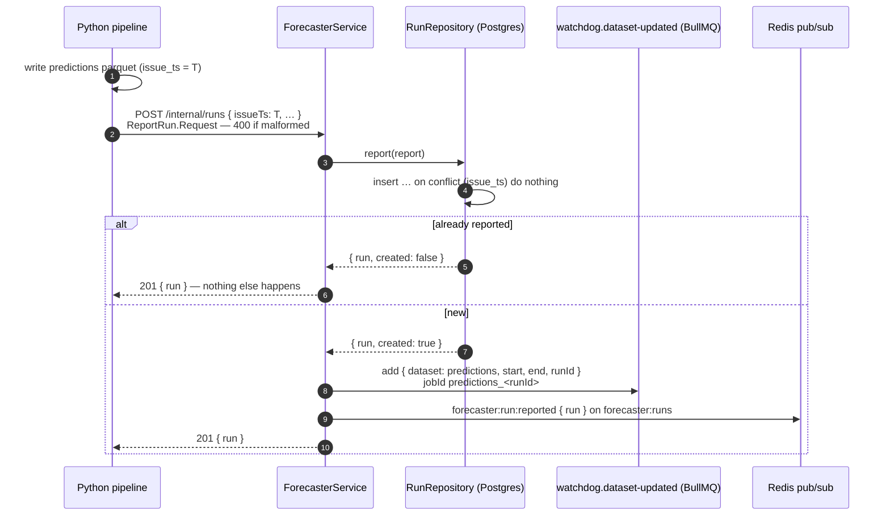

# Reporting a run

`POST /internal/runs` — from the Python pipeline, once a run's predictions are fully written to their parquet file.

```jsonc
{
  "issueTs":         "2026-05-13T07:00:00Z",                 // when the forecast was made; one run per issueTs
  "modelVersion":    "lgbm-2026-05-10",
  "rows":            168,                                    // forecast hours written
  "predictionsPath": "data/processed/predictions.parquet",   // the file; the run's rows are those with this issue_ts
  "start":           "2026-05-13T21:00:00Z",                 // its first target hour (local midnight of D+1)
  "end":             "2026-05-20T21:00:00Z"                  // the hour after its last: [start, end) is the update
}
```

`Forecaster.API.Internal.ReportRun` (`shared/domain/Forecaster/api/internal.ts`): request is `Forecaster.Run.Report`, response `{ run }`. `start` and `end` aren't stored with the run — they only make the update.

## The flow

Reporting is the run's **completion notice**: the file may be written in pieces, so the Watchdog only reads it once Python says it's done. It's idempotent on `issueTs` — a pipeline that retries the call after a timeout gets the same run back, and nothing is queued twice.



From here the Watchdog takes over: [checking-an-update.md](checking-an-update.md).

## What gets created

| Where | What |
|---|---|
| `gridsense.run` | `id` (UUIDv7, server-made), `issue_ts` (unique), `model_version`, `row_count`, `predictions_path`, `reported_at` |
| `watchdog.dataset-updated` | one job `{ dataset: "predictions", start, end, runId }`, id `predictions_<runId>` |
| `forecaster:runs` | `forecaster:run:reported { run }` — the dashboard's run list updates live |

## Why the server queues it, not Python

- Python only has to speak HTTP + JSON, not BullMQ's job format.
- The run has to be in Postgres anyway: the Watchdog asks for **the run before** this one (`GET /internal/runs/:id/previous`, for `p_near_zero_change`) and **the latest run before a day** (`GET /internal/runs/latest?before=`, for the auction check). Saving and queueing in one place keeps them in step.
- A queue rather than pub/sub: if the Watchdog is down, the job waits.

## Reading runs

| Endpoint | For | Returns |
|---|---|---|
| `GET /api/runs?limit=` | the dashboard | newest first |
| `GET /internal/runs/:id` | `HourService.forRun` | the run, 404 if none |
| `GET /internal/runs/:id/previous` | `HourService.readForecast` | the run issued just before, or `null` |
| `GET /internal/runs/latest?before=` | `HourService.forDeliveryDay` | the latest run issued before that instant, or `null` (declared before `:id`, which would take `latest` for an id) |
