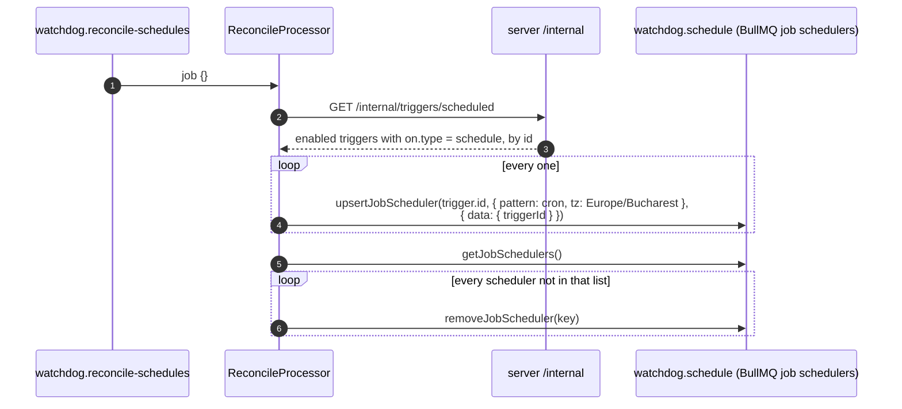
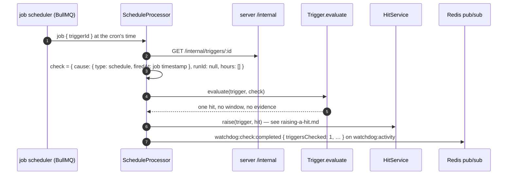

# Scheduled triggers

A trigger with `on: { type: "schedule", cron: "0 8 * * MON" }` is checked on the clock (Romanian time, `Time.Local.TIME_ZONE = "Europe/Bucharest"`), not when a dataset updates. It has no hours, so no conditions: it holds every time it fires. The weekly report is one.

There's no cron loop of our own: **BullMQ's job schedulers** fire it. One scheduler per enabled scheduled trigger, on the `watchdog.schedule` queue, its id the trigger's id. Keeping those in line with the triggers in Postgres is **reconciling**.

## Reconciling

`watchdog.reconcile-schedules` — an empty job, queued by `TriggerService` after every create, update and delete ([editing-triggers.md](editing-triggers.md)), and by the Watchdog on boot (`Schedules.onApplicationBootstrap`), for changes made while it was down.

It's a full sync, not a diff of the change: whatever happened (a trigger deleted, disabled, moved from cron to a dataset, a cron edited), the schedulers end up matching Postgres. Concurrency 1, so two reconciles never interleave.

## A schedule firing

The hit's thread id ends in `schedule-<firedAt ms>`: one thread per firing. Its cooldown key is `<triggerId>_run`, so a cooldown on a scheduled trigger means "at most once per cooldown", whatever the cron says.

What the agent does with a report hit — read the week's runs and hits, write the report — is up to its graph ([handling-a-hit.md](handling-a-hit.md)); the hit only says "it's time".
